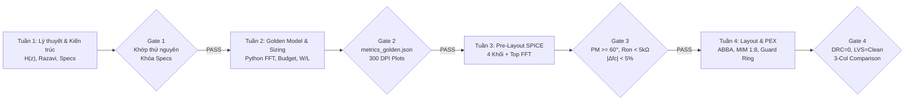

# KẾ HOẠCH TỔNG THỂ & BẢNG THEO DÕI TIẾN ĐỘ 4 TUẦN (`sky130-sc-lpf`)

**Dự án:** Thiết kế Mạch lọc thông thấp tụ chuyển mạch trên tiến trình SkyWater 130nm (`sky130-sc-lpf`)  
**Vai trò điều phối:** Principal Analog IC Design Lead & Project Manager  
**Cập nhật lần cuối:** 2026-11-26 (Hoàn tất 4/4 Tuần & Nâng cấp Trọn bộ 79 Slide Trắng–Xanh biển–Vàng + Ký hiệu Logic IEEE chuẩn)

---

## 1. Bảng Tiến Độ Tổng Quan (`/status`)

| Tuần | Giai đoạn | Hạng mục công việc (WBS) | Cổng kiểm định (Verification Gate) | Deliverable chính | Trạng thái |
| :---: | :--- | :--- | :--- | :--- | :---: |
| **0** | **Khởi tạo & Hạ tầng** | Thiết lập Rules (`GEMINI.md`), 3 Skills, Knowledge Base, cấu trúc Repo & `env_sky130.sh` | Xác minh `sky130A`, Python stack, Ngspice-47, Xschem, Magic, KLayout, Netgen | `GEMINI.md`, `.agents/skills/*`, `docs/knowledge/*` | ✅ **HOÀN TẤT** |
| **1** | **Lý thuyết & Kiến trúc** | **1.1** Design Rationale: Cầu nối Tín hiệu & Hệ thống $\Longrightarrow$ Thông số Chip ($N=1, f_c, f_{\text{clk}}, K=8, kT/C, \text{PM}\ge 60^\circ$) **1.2** Lý thuyết Razavi Ch.2–9 ($H(z)$, `.op/.ac/.tran` LTI vs LPTV, ký sinh, 5T-OTA) **1.3** Xác minh `sky130A` + `week1_verify.py` + Giao diện Trắng–Xanh biển–Vàng + Ký hiệu IEEE | Toàn bộ 22/22 công thức khớp thứ nguyên; khóa cứng bảng thông số & sơ đồ 4 khối | `docs/week1_theory_notes.md` `python/week1_numbers.json` `slides/week1_slides.html` (20 slides IEEE nền sáng + 5 biểu đồ 300 DPI + Speaker Notes) | ✅ **HOÀN TẤT (PASS GATE 1)** |
| **2** | **Python Golden Model & Sizing** | **2.1** `python/golden_model.py` (Bode $H(z)$ vs $RC$, quá độ đa tần, Coherent FFT $N=16384$) **2.2** `python/nonideal_budget.py` (Quét $R_{\text{on}}, A_{OL}$, Charge Injection, $kT/C$) **2.3** `python/sizing_calc.py` (Bảng $W/L, \text{nf}, \text{mult}$ 4 khối kiểm chứng BSIM4) + Bộ slide Socratic dẫn dắt | Có `metrics_golden.json`, 5 biểu đồ PNG 300 DPI không đè chữ, bảng Sizing sẵn sàng nhập Xschem | `python/*.py`, `python/metrics_golden.json`, `python/sizing_table.json`, 5 PNG 300 DPI, `slides/week2_slides.html` (20 slides Socratic Q&A) | ✅ **HOÀN TẤT (PASS GATE 2)** |
| **3** | **Schematic & Pre-Layout Ngspice** | **3.1** Chuẩn hóa 9 cell Xschem với ký hiệu IEEE (`NOT, NAND2, AND2, TG, Dummy, 5T-OTA`) + `non_overlap_clk` ($t_{\text{nov}}=3.12\text{ ns}$) **3.2** `tg_switch` ($R_{\text{on,max}}=4.43\text{ k}\Omega$) **3.3** `sc_core` & `ota_5t` ($A_{OL}=41.6\text{ dB}, \text{GBW}=43.6\text{ MHz}, \text{PM}=81.0^\circ$) **3.4** `top_sc_lpf` ($f_c=193.97\text{ kHz}, +3.36\%$, $\text{SFDR}=54.14\text{ dB}$) + Ảnh chụp workstation nền sáng & composite | $t_{\text{nov}} \in [2,5]\text{ ns}$; $R_{\text{on}} < 5\text{ k}\Omega$; `M1–M5` bão hòa, $A_{OL}>35\text{–}40\text{ dB}$, $\text{GBW}>10\text{ MHz}$, $\text{PM}\ge 60^\circ$; $|\Delta f_c| < 5\%$ vs Golden | `xschem/*.sch/.sym` (9 cells, `ERC=0`), `ngspice/*.spice`, `docs/week3_prelayout_notes.md`, 14 PNGs (100% nhúng vào slide), `slides/week3_slides.html` (20 slides Socratic Q&A) | ✅ **HOÀN TẤT (PASS GATE 3)** |
| **4** | **Layout Magic, DRC/LVS & PEX** | **4.1** Layout Magic (`149.30×101.30 µm`, Multi-finger `nf=2`, 5T-OTA 36 ngón `ABBA/ABBA-BAAB`, MIM $5\times 5$ Common-Centroid $1:8$ + 16 Dummy, `met4` Top-Plate `VX`, `P+/N-Well Guard Rings`) **4.2** Physical Verification (Magic DRC = `0`, KLayout FEOL+BEOL+OFFGRID DRC = `0`, Netgen LVS = `Circuits match uniquely`) **4.3** PEX (`ext2spice cthresh 0`, 123 tụ ghép = $284.2\text{ fF}$) + Hậu kiểm 3 cột ($f_{c,\text{PEX}}=203.45\text{ kHz}, +4.89\%\text{ vs Pre}$, $\text{SFDR}=53.60\text{ dB}$, $\text{PM}=80.45^\circ$, $P=116.1\ \mu\text{W}$) | DRC = `0 errors`, LVS = `Clean`, `.gds` hợp lệ, bảng đối chiếu 3 cột giữ vững đặc tuyến LPF | `layout/*.mag`, `layout/top_sc_lpf.gds`, `layout/lvs_report.out`, `layout/klayout_drc_report.xml`, `docs/week4_postlayout_notes.md`, 7 PNGs, `slides/week4_slides.html` (19 slides) &amp; `slides/index.html` (79 slides tổng hợp 4 tuần) | ✅ **HOÀN TẤT (PASS GATE 4)** |

---

## 2. Sơ Đồ Luồng Công Việc & Cổng Kiểm Định 4 Tuần

---

## 3. Danh Mục Lệnh Điều Khiển Nhanh
- `/status` — Xem bảng tiến độ cập nhật mới nhất và các hạng mục còn thiếu.
- `/tuan [1-4]` — Mở checklist chi tiết, dẫn xuất lý thuyết và hướng dẫn thực thi của tuần đó.
- `/code [ten_nhiem_vu]` — Sinh mã Python / netlist Ngspice kèm chạy kiểm chứng và giải thích vật lý.
- `/review [so_lieu_hoac_anh]` — Chấm điểm số liệu đo thực tế với Verification Gate và hướng dẫn tinh chỉnh $W/L$.
- `/slide [1-4] [html|gamma|pptx]` — Xuất bộ slide chuẩn hội nghị IEEE/ISSCC (mặc định khuyên dùng `html` 16:9 + KaTeX).
