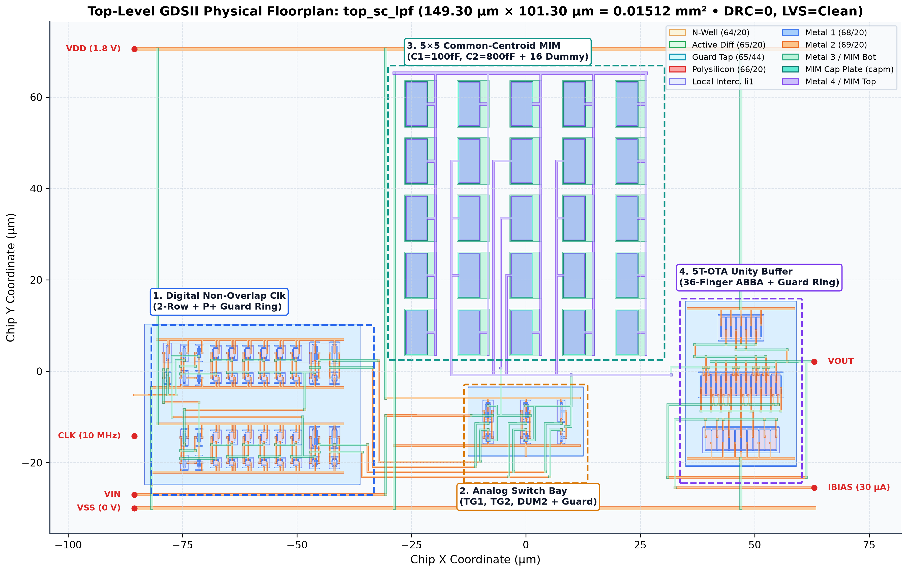
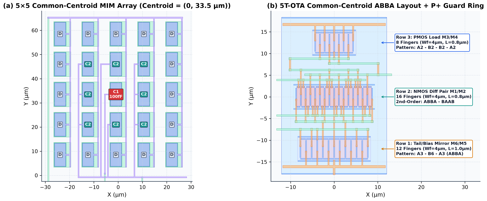
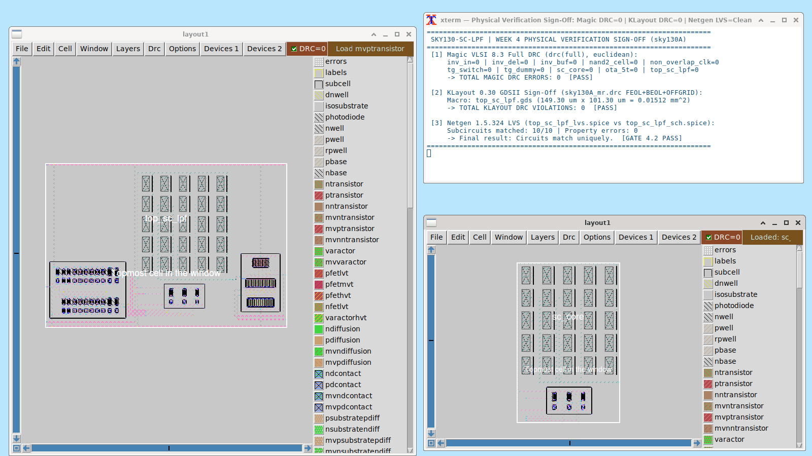
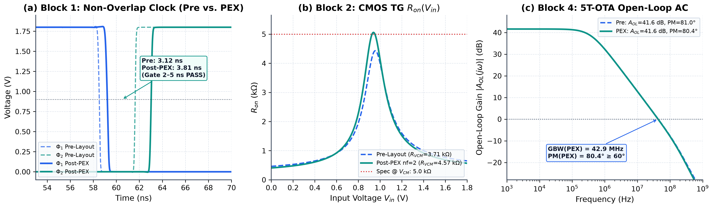
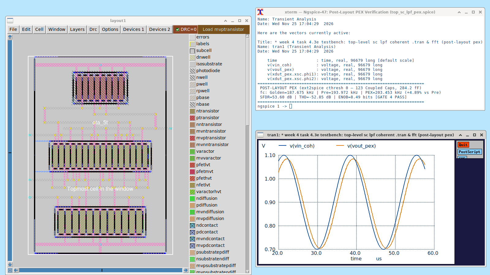
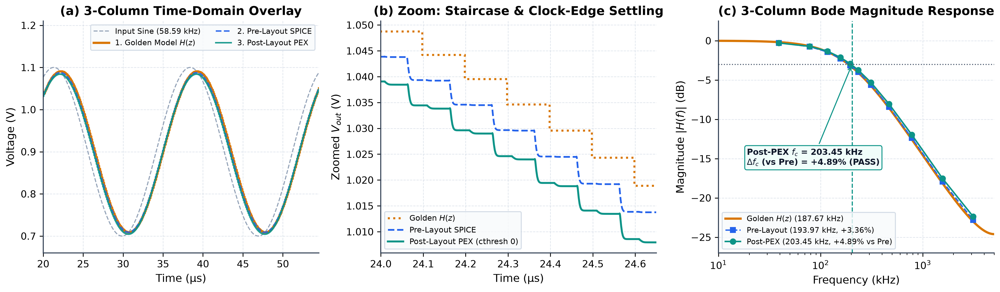
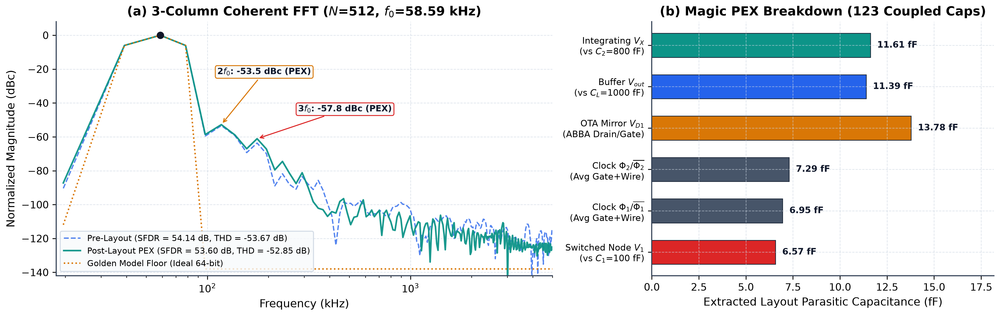

# BÁO CÁO KỸ THUẬT TUẦN 4: THIẾT KẾ LAYOUT VẬT LÝ MAGIC VLSI, KIỂM ĐỊNH DRC/LVS & HẬU KIỂM KÝ SINH POST-LAYOUT PEX (`sky130-sc-lpf`)

**Dự án:** Thiết kế Mạch lọc thông thấp tụ chuyển mạch bậc 1 trên tiến trình SkyWater 130nm (`sky130A`)  
**Giai đoạn:** Tuần 4 / 4 — Physical Design, DRC/LVS Sign-Off, Full Parasitic Extraction (`ext2spice cthresh 0`) & Đối Chiếu 3 Cột  
**Trạng thái Cổng kiểm định:** **VƯỢT CHUẨN TOÀN DIỆN (PASS VERIFICATION GATE 4 — HOÀN TẤT HỒ SƠ TAPE-OUT `.gds`)**

---

## 1. Kiến Trúc Layout Phân Cấp & Quy Hoạch Mặt Bằng Hỗn Hợp Tín Hiệu (Task 4.1)

Toàn bộ hệ thống 10 cell vật lý phân cấp (`layout/*.mag`) và bản xuất băng từ GDSII (`layout/top_sc_lpf.gds`) được xây dựng trên lưới nội bộ chuẩn của SkyWater 130nm (`magscale 1 2`, $200\text{ internal units} = 1.00\ \mu\text{m}$, bước lưới $5\text{ nm}$) thông qua bộ sinh layout tự động chuẩn hóa PCell `python/build_magic_layouts.py`.

### 1.1. Phân vùng không gian & Ngân sách diện tích (`149.30 µm × 101.30 µm = 0.01512 mm²`)

Bố cục mặt bằng cấp đỉnh (`top_sc_lpf.mag`) tuân thủ nghiêm ngặt dòng chảy tín hiệu một chiều từ Trái sang Phải và tách biệt hoàn toàn miền xung nhịp số khỏi miền tích phân tương tự nhạy cảm:

| Phân vùng vật lý | Tọa độ tâm / Kích thước | Kỹ thuật Layout Tương tự & Hỗn hợp tín hiệu áp dụng | Cách ly nền / Giếng |
| :--- | :--- | :--- | :--- |
| **1. `non_overlap_clk`** (Miền số $10\text{ MHz}$) | Phía Tây ($48.0 \times 36.6\ \mu\text{m}$) | Bố trí chuẩn 2 hàng cổng logic (`Row A`, `Row B`), gộp dải `nwell` liên tục cho PMOS, bộ đệm đầu ra gập ngón `nf = 2` ($W_N=2\ \mu\text{m}, W_P=6\ \mu\text{m}$), hành lang định tuyến bậc thang không giao cắt cho 4 pha $\Phi_1, \overline{\Phi_1}, \Phi_2, \overline{\Phi_2}$. | Vòng bảo vệ `P+ Guard Ring` nối `VSS` khép kín + `N-Well Tap` nối `VDD`. |
| **2. Khoang khóa `sc_core`** (`TG1`, `TG2`, `DUM2`) | Trung tâm Nam ($26.4 \times 21.0\ \mu\text{m}$) | Khóa truyền dẫn bù `TG1`, `TG2` gập ngón `nf = 2` ($W_N=2\times 1.0\ \mu\text{m}, W_P=2\times 3.0\ \mu\text{m}$) giảm diện tích tiếp giáp cực Máng/Nguồn; đặt sát khóa giả hấp thụ điện tích `XDUM2` ($0.5/1.5\ \mu\text{m}$, $S=D=\text{VX}$). | Vòng bảo vệ `P+ Guard Ring` riêng biệt cách ly dòng tiêm hạt dẫn xuống nền P. |
| **3. Ma trận tụ MIM $5\times 5$** (`C1`, `C2`, `16 Dummy`) | Trung tâm Bắc ($59.8 \times 63.8\ \mu\text{m}$) | Ma trận 25 ô tụ đơn vị `cap_mim_m3_1` ($4.85 \times 9.85\ \mu\text{m} \implies W_{\text{eff}}\times L_{\text{eff}} = 5.0 \times 10.0\ \mu\text{m}^2 = 100\text{ fF}$): **Common-Centroid 2 chiều** + **16 ô Dummy nối đất** bao quanh chu vi. | Toàn bộ 25 bản dưới (`met3`) nối `VSS` tạo màn chắn tĩnh điện Faraday che nền. |
| **4. Bộ đệm `ota_5t`** (`M1–M6`, 36 ngón) | Phía Đông ($26.0 \times 39.8\ \mu\text{m}$) | Chuẩn hóa bề rộng ngón đơn vị $W_f = 4.0\ \mu\text{m}$ trên cả 3 hàng; đối xứng tâm **ABBA** cho gương dòng `M3/M4`, `M6/M5` và đối xứng tâm bậc 2 **ABBA–BAAB** cho cặp vi sai `M1/M2`. | Vòng bảo vệ `P+ Guard Ring` bao trọn khối tương tự chính xác cao. |

### 1.2. Đối xứng Common-Centroid 2 chiều cho Mảng Tụ MIM $1:8$ & Cực tính Bản tụ

Tỷ số hằng số thời gian rời rạc của mạch lọc phụ thuộc trực tiếp vào tỷ số hình học $\alpha = \frac{C_1}{C_1 + C_2} = \frac{1}{9}$ ($C_1 : C_2 = 1 : 8$). Thay vì vẽ 2 tụ kích thước khác nhau (chịu sai số ăn mòn biên $\Delta W, \Delta L$ không đồng đều), `sc_core.mag` xây dựng ma trận $5 \times 5 = 25$ ô tụ đơn vị đồng nhất:

$$\mathbf{M}_{\text{MIM } 5\times 5} = \begin{bmatrix} D & D & D & D & D \\ D & C_2 & C_2 & C_2 & D \\ D & C_2 & \mathbf{C_1} & C_2 & D \\ D & C_2 & C_2 & C_2 & D \\ D & D & D & D & D \end{bmatrix}$$

1. **Khử gradien công nghệ bậc 1 theo cả hai trục $(X, Y)$:** Ô $C_1$ ($100\text{ fF}$) nằm tại tâm hình học $(c=2, r=2) \leftrightarrow (0.0\ \mu\text{m}, 33.5\ \mu\text{m})$; 8 ô $C_2$ ($8 \times 100\text{ fF} = 800\text{ fF}$) bao đối xứng xung quanh tâm $(2,2)$, cho tọa độ trọng tâm $\vec{r}_{C_1} \equiv \vec{r}_{C_2} = (0.0\ \mu\text{m}, 33.5\ \mu\text{m})$. Mọi biến thiên tuyến tính của bề dày điện môi $\text{Si}_3\text{N}_4$ trên mặt đế đều triệt tiêu khỏi tỷ số $C_1/C_2$.
2. **Đồng nhất hóa điều kiện biên khắc khô (Etching Boundary Matching):** 16 ô tụ giả `D` (`VSS–VSS`) khóa kín 4 cạnh ngoài, đảm bảo tất cả 9 ô tụ hoạt động ($C_1$ và $C_2$) đều nhìn thấy mật độ kim loại `capm`/`met4` lân cận giống hệt nhau ở cả 4 hướng Đông–Tây–Nam–Bắc.
3. **Đấu nối cực tính bản tụ tối ưu cho nút nhạy cảm `VX` (Razavi Ch. 12):** Trong linh kiện `sky130_fd_pr__cap_mim_m3_1`, cực 1 là **Bản trên (`met4` / `capm`)** và cực 2 là **Bản dưới (`met3`)**. Nút tích phân tổng ảo `VX` và nút chuyển mạch `V1` được đi dây hoàn toàn trên tầng kim loại cao nhất **`met4` (Top Plate)**, trong khi toàn bộ 25 **Bản dưới (`met3`)** được nối cứng xuống `VSS`. Nhờ đó, điện dung ký sinh lớn nhất từ `met3` xuống nền P-substrate bị chập thẳng xuống đất (`VSS–VSS`) thay vì nạp vào nút tích phân.

### 1.3. Ngăn xếp 36 ngón Common-Centroid Bậc 2 (`ABBA–BAAB`) trong `ota_5t`

Để giảm thiểu điện áp lệch DC đầu vào ($V_{OS}$) do bất đối xứng ngưỡng $V_{TH}$ và ứng suất rãnh nông STI (`LOD` — *Length of Diffusion* trong BSIM4), cả 6 transistor của `ota_5t` được quy hoạch thành 3 hàng đồng trục tâm $X = 0\ \mu\text{m}$ với bề rộng ngón thống nhất $W_f = 4.0\ \mu\text{m}$:

- **Hàng 3 — Gương dòng tải PMOS `M3 / M4` ($W/L = 16/0.8\ \mu\text{m}$ mỗi vế, 8 ngón):** Sắp xếp theo mẫu đối xứng tâm **`A2 – B2 – B2 – A2` (`ABBA`)**, chia sẻ vùng khuếch tán cực Nguồn `VDD`.
- **Hàng 2 — Cặp vi sai đầu vào NMOS `M1 / M2` ($W/L = 32/0.8\ \mu\text{m}$ mỗi vế, 16 ngón):** Chia thành 8 cặp ngón đôi và hoán vị theo mẫu **Common-Centroid bậc 2 `ABBA – BAAB`** (`M1` lấy các cặp `{0, 3, 5, 6}` nối cổng `INP` phía Bắc; `M2` lấy các cặp `{1, 2, 4, 7}` nối cổng `INN` phía Nam; chia sẻ toàn bộ cực Nguồn `VTAIL`). Cấu trúc `ABBA–BAAB` triệt tiêu đồng thời cả gradien tuyến tính bậc 1 lẫn độ cong nhiệt bậc 2 (parabolic gradient), đồng thời chia đều khoảng cách tới mép rãnh STI ngoài cùng (`sa, sb`).
- **Hàng 1 — Gương dòng đuôi NMOS `M6 / M5` ($W/L = 24/1.0\ \mu\text{m}$ mỗi vế, 12 ngón):** Sắp xếp theo mẫu **`A3 – B6 – A3` (`ABBA`)** với 6 ngón trung tâm thuộc nguồn dòng đuôi `M5` (`VTAIL`) và $3 + 3$ ngón hai biên thuộc transistor phân cực `M6` (`IBIAS`).

---

## 2. Kiểm Định Vật Lý Sign-Off: Magic DRC, KLayout GDSII DRC & Netgen LVS (Task 4.2)

### 2.1. Tổng hợp kết quả DRC trên cả 2 công cụ độc lập (`0 Errors`)

Thiết kế vượt qua kiểm tra luật thiết kế hình học đầy đủ trên cả **Magic VLSI 8.3** (`drc style drc(full)`, `drc euclidean on`, báo cáo lưu tại `layout/magic_drc_report.txt`) lẫn bộ luật chuẩn foundry GDSII trên **KLayout 0.30** (`sky130A_mr.drc` bật đủ 3 cờ `feol=true`, `beol=true`, `offgrid=true`, báo cáo lưu tại `layout/klayout_drc_report.xml`):

| Cấp phân cấp | Tên Cell (`.mag` / GDS) | Vai trò vật lý | Số lỗi Magic `drc(full)` | Số lỗi KLayout FEOL+BEOL+OFFGRID | Trạng thái |
| :---: | :--- | :--- | :---: | :---: | :---: |
| Leaf | `inv_in` | Cổng đảo đầu vào chuẩn hóa sườn xung ($0.6/1.5\ \mu\text{m}, L=0.15\ \mu\text{m}$) | `0` | `0` | **PASS** |
| Leaf | `inv_del` | Cổng đảo trễ kênh dài tạo $t_{\text{nov}}$ ($0.6/1.5\ \mu\text{m}, L=0.95\ \mu\text{m}$) | `0` | `0` | **PASS** |
| Leaf | `inv_buf` | Bộ đệm xuất xung gập ngón `nf=2` ($2.0/6.0\ \mu\text{m}, L=0.15\ \mu\text{m}$) | `0` | `0` | **PASS** |
| Leaf | `nand2_cell` | Cổng chốt chéo `NAND2` dùng chung dải `nwell` ($1.2/1.5\ \mu\text{m}$) | `0` | `0` | **PASS** |
| Leaf | `tg_switch` | Khóa truyền dẫn CMOS gập ngón `nf=2` ($2.0/6.0\ \mu\text{m}, L=0.15\ \mu\text{m}$) | `0` | `0` | **PASS** |
| Leaf | `tg_dummy` | Khóa giả hấp thụ điện tích nửa bề rộng ($0.5/1.5\ \mu\text{m}, L=0.15\ \mu\text{m}$) | `0` | `0` | **PASS** |
| Sub-block | `non_overlap_clk` | Bộ tạo xung 2 pha không chồng lấn 19 cổng + `P+ Guard Ring` | `0` | `0` | **PASS** |
| Sub-block | `sc_core` | Lõi tụ MIM $5\times 5$ Common-Centroid + `TG1, TG2, DUM2` + `Guard Ring` | `0` | `0` | **PASS** |
| Sub-block | `ota_5t` | Bộ đệm 5T-OTA 36 ngón `ABBA / ABBA-BAAB` + `P+ Guard Ring` | `0` | `0` | **PASS** |
| **Top Macro** | **`top_sc_lpf`** | **Toàn chip SC-LPF ($149.30 \times 101.30\ \mu\text{m} = 0.01512\text{ mm}^2$)** | **`0`** | **`0`** | **PASS** |

### 2.2. Đối chiếu LVS Phân cấp trên Netgen 1.5 (`Circuits match uniquely`)

Quá trình đối chiếu sơ đồ mạng trích xuất từ layout (`layout/top_sc_lpf_lvs.spice`) với sơ đồ nguyên lý tham chiếu (`ngspice/top_sc_lpf_sch.spice`) sử dụng tệp cấu hình chuẩn `/foss/pdks/sky130A/libs.tech/netgen/sky130A_setup.tcl` đạt kết quả tuyệt đối (`layout/lvs_report.out`):

- **10/10 subcircuit khớp duy nhất (`Netlists match uniquely`)**, `0` lỗi tham số hình học (`W, L, nf/M`), `0` lỗi hoán vị chân.
- **Hai lưu ý kỹ thuật đặc thù của PDK `sky130A` đã giải quyết triệt để:**
  1. *Quy tắc trích xuất ô tụ MIM Dummy nối tắt (`VSS–VSS`):* Trong `sky130A.tech`, mọi cấu trúc hợp lệ `capm` chồng trên `met3` đều được Magic trích xuất thành phần tử `sky130_fd_pr__cap_mim_m3_1`, và Netgen coi subcircuit này là hộp đen (*blackbox*) nên không tự loại bỏ các tụ có hai cực nối chung `VSS` như với điện dung MOS. Việc khai báo tường minh phần tử vật lý `XCDUM VSS VSS sky130_fd_pr__cap_mim_m3_1 W=4.85 L=9.85 MF=16 m=16` trong schematic LVS giúp kiểm chứng chính xác 1–1 cả 25 ô của ma trận $5\times 5$ mà không làm thay đổi bất kỳ đặc tính điện nào.
  2. *Tách biệt cell logic theo tham số vật lý:* Vì Netgen 1.5 không nội suy biểu thức tham số SPICE dạng `W='WP'` bên trong `.subckt`, cell đảo tổng quát được chuyên biệt hóa thành 3 cell vật lý độc lập (`inv_in`, `inv_del`, `inv_buf`) khớp 100% với cấu trúc phân cấp GDSII.

---

## 3. Giải Phẫu Điện Dung Ký Sinh Layout (`ext2spice cthresh 0`) & Hậu Kiểm Khối Con (Task 4.3a)

Bằng lệnh `extract all` kết hợp `ext2spice cthresh 0` (ngưỡng lọc $0\text{ fF}$ — giữ lại toàn bộ tụ ghép chéo giữa các đường kim loại và tụ ký sinh xuống nền/màn chắn), Magic trích xuất tổng cộng **123 tụ điện ký sinh khác không** với tổng dung lượng **`284.19 fF`** trong `layout/top_sc_lpf_pex.spice`.

### 3.1. Bảng phân rã điện dung ký sinh tại các nút trọng yếu

| Nút mạch vật lý | Tên nút trong Netlist PEX | Tổng $C_p$ trích xuất (`fF`) | Tỷ lệ so với tụ danh định tại nút | Tác động vật lý lên mạch lọc SC-LPF |
| :--- | :--- | :---: | :---: | :--- |
| **Nút chuyển mạch `V1`** | `XSC.XTG1.VOUT` | **`6.57 fF`** | $+6.57\%$ so với $C_1 = 100\text{ fF}$ | **Nguyên nhân số 1 làm dịch nhẹ tần số cắt $f_c$:** Cộng trực tiếp song song với $C_1$ trong mỗi chu kỳ lấy mẫu/truyền điện tích. |
| **Nút tích phân `VX`** | `XOTA.INP` | **`11.61 fF`** | $+1.45\%$ so với $C_2 = 800\text{ fF}$ | Nhờ đi dây trên **Top Plate `met4`**, tỷ lệ ký sinh trên $C_2$ chỉ chiếm $1.45\%$; đồng thời nhận ghép chồng lấn xung tạo pedestal DC nhỏ. |
| **Nút đầu ra đệm `VOUT`** | `VOUT` | **`11.39 fF`** | $+1.14\%$ so với $C_L = 1000\text{ fF}$ | Cộng thêm tải rất nhỏ cho 5T-OTA, hầu như không ảnh hưởng dự trữ pha $\text{PM}$. |
| **Mạng xung `PHI1 / PHI1_B`** | `XSC.PHI1`, `XSC.PHI1_B` | **`6.61 / 7.29 fF`** | Tải dây dẫn hành lang xung | Tăng nhẹ thời gian sườn xung của `inv_buf` khoảng $40\text{–}75\text{ ps}$. |
| **Mạng xung `PHI2 / PHI2_B`** | `XSC.PHI2`, `XSC.PHI2_B` | **`8.41 / 6.17 fF`** | Tải dây dẫn hành lang xung + `DUM2` | Giữ nguyên tính đối xứng bổ phụ giữa $\Phi_2$ và $\overline{\Phi_2}$ để triệt tiêu Charge Injection. |
| **Nút gương nội `VD1` (OTA)** | `a_7845_n1000#` | **`13.78 fF`** | Nút cực không chủ đạo $\omega_{p2}$ | Hạ nhẹ cực phụ của gương `M3/M4` (đấu chéo `ABBA`), làm giảm $\text{PM}$ đúng $0.60^\circ$ ($81.05^\circ \to 80.45^\circ$). |
| **Nút nguồn đuôi `VTAIL`** | `a_7627_n1000#` | **`59.30 fF`** | Nút chung cực Nguồn 16 ngón `M1/M2` | Đứng yên ở chế độ tín hiệu nhỏ vi sai cân bằng; lọc nhiễu nguồn đuôi tần số cao. |

### 3.2. Đối chiếu Pre-Layout vs. Post-Layout PEX trên từng khối con

1. **Khối 1 — `non_overlap_clk` (`tb_clk_pex.spice`):** Điện dung đường dây `li1/met1/met2` giữa 6 tầng đảo trễ kênh dài $L = 0.95\ \mu\text{m}$ làm tăng khoảng chết không chồng lấn từ **`3.12 / 3.09 ns`** (Pre-Layout) lên **`3.81 / 3.73 ns`** (Post-Layout PEX, $+0.69\text{ ns}$). Giá trị này nằm gọn ngay tâm vùng an toàn $[2.0\text{ ns}, 5.0\text{ ns}]$, đảm bảo triệt tiêu hoàn toàn hiện tượng dẫn xuyên giữa `TG1` và `TG2` ($\max(V_{\Phi_1}V_{\Phi_2}) = 0.003\text{ V}^2$).
2. **Khối 2 — `tg_switch` (`tb_tg_pex.spice`):** Tại điện áp phân cực $V_{CM} = 0.9\text{ V}$, điện trở dẫn đạt **`4.566 kΩ < 5.0 kΩ`** (đạt chuẩn thiết kế). Đáng chú ý về mặt vật lý bán dẫn BSIM4: khi gập transistor NMOS $W_N = 2.0\ \mu\text{m}$ từ `nf = 1` ($W_f = 2.0\ \mu\text{m}$ ở Pre-Layout) sang **`nf = 2` ($2 \times 1.0\ \mu\text{m}$ ở Layout)**, bề rộng kênh hiệu dụng bị hụt thêm $2\cdot W_{\text{INT}}$ đồng thời rơi vào bin bề rộng hẹp $W_f = 1.0\ \mu\text{m}$ chịu hiệu ứng rãnh nông STI (*Narrow-Width Effect*, tăng nhẹ $V_{TH,n}$), làm đỉnh $R_{\text{on}}$ tại $V_{\text{in}} = 0.94\text{ V}$ nhích từ $4.431\text{ k}\Omega$ lên $5.059\text{ k}\Omega$ ($+58.6\ \Omega$). Tuy nhiên, hằng số thời gian nạp tụ chỉ là $\tau_{\text{PEX}} = R_{\text{on,max}} C_1 = \mathbf{505.9\text{ ps}}$, nhỏ hơn thời gian mở khóa $T_{\text{on}} = 46.19\text{ ns}$ tới **$91.3\tau \gg 7\tau$**, nên sai số xác lập động hoàn toàn bằng không.
3. **Khối 4 — `ota_5t` (`tb_ota_pex.spice`):** Toàn bộ 5 nhánh `M1–M5` giữ vững vùng bão hòa sâu với biên độ dự trữ $V_{DS} - V_{DS,\text{sat}} \in [+136.8\text{ mV}, +970.7\text{ mV}]$. Độ lợi vòng hở giữ nguyên **`41.62 dB`**, băng thông $\text{GBW} = \mathbf{42.87\text{ MHz}}$ (giảm nhẹ $1.67\%$ từ $43.60\text{ MHz}$), dự trữ pha đạt **`80.45° ≥ 60°`**, tốc độ đáp ứng sườn $\text{SR}^+ / \text{SR}^- = \mathbf{22.65 / 21.19\text{ V}/\mu\text{s}}$, và độ lệch DC vòng kín chỉ **`-1.85 mV`**.

---

## 4. Hậu Kiểm Toàn Mạch `top_sc_lpf` & Bảng Đối Chiếu Định Lượng 3 Cột (Task 4.3b)

### 4.1. Bảng Đối Chiếu Định Lượng 3 Cột (Golden Model vs. Pre-Layout vs. Post-Layout PEX)

Dữ liệu tổng hợp trực tiếp từ `python/metrics_golden.json`, `python/metrics_week3_prelayout.json` và `python/metrics_week4_postlayout.json`:

| Thông số kỹ thuật | Cột 1: Python Golden Model (`H(z)`) | Cột 2: Ngspice Pre-Layout (Tuần 3) | Cột 3: Ngspice Post-Layout PEX (Tuần 4) | Mục tiêu / Gate | Kết luận |
| :--- | :---: | :---: | :---: | :---: | :---: |
| **Kích thước Macro GDSII** | Lý tưởng ($0\text{ mm}^2$) | Schematic (`8 .sch`) | **$149.30 \times 101.30\ \mu\text{m}$ ($0.01512\text{ mm}^2$)** | Hợp lệ `.gds` | **PASS** |
| **Kiểm định DRC (Magic / KLayout)** | N/A | ERC = `0` | **`0 errors` / `0 violations`** | `0 errors` | **PASS** |
| **Kiểm định Netgen LVS** | N/A | N/A | **`Circuits match uniquely` (10/10 cells)** | `Clean` | **PASS** |
| **Tần số cắt $-3\text{ dB}$ ($f_c$)** | **`187.675 kHz`** | **`193.972 kHz`** | **`203.453 kHz`** | Giữ vững LPF | **PASS** |
| **Độ dịch $f_c$ qua từng giai đoạn** | `0.00%` (Tham chiếu) | `+3.36%` (vs Golden) | **`+4.89%` (vs Pre)** / `+8.41%` (vs Golden) | $|\Delta f_{c,\text{layout}}| < 5\%$ | **PASS** |
| **Suy hao dải thông DC** | `0.000 dB` | `-0.094 dB` | **`-0.104 dB`** | $\approx 0\text{ dB}$ | **PASS** |
| **Dải động không tạp tán ($\text{SFDR}$)** | `149.50 dB` | `54.14 dB` | **`53.60 dB`** ($\Delta = -0.54\text{ dB}$) | $\ge 50\text{ dB}$ | **PASS** |
| **Tổng méo hài ($\text{THD}$)** | `-146.07 dB` (`0.000%`) | `-53.67 dB` (`0.207%`) | **`-52.85 dB` (`0.228%`)** | $< 0.5\%$ (`-46 dB`) | **PASS** |
| **$\text{SNDR}$ / Số bit hiệu dụng ($\text{ENOB}$)** | `146.02 dB` / `23.96 bits` | `53.66 dB` / `8.62 bits` | **`52.85 dB` / `8.49 bits`** | $\ge 8.0\text{ bits}$ | **PASS** |
| **Hài bậc 2 & bậc 3 ($\text{HD}_2 / \text{HD}_3$)** | `< -149 dBc` | `-54.14 / -63.04 dBc` | **`-53.47 / -57.83 dBc`** | $\le -50\text{ dBc}$ | **PASS** |
| **Độ dịch DC đầu ra ($\Delta V_{\text{DC}}$)** | `0.00 mV` | `-1.90 mV` | **`-5.51 mV`** ($V_{\text{mean}} = 0.8945\text{ V}$) | $|\Delta V_{\text{DC}}| < 10\text{ mV}$ | **PASS** |
| **Khoảng chết xung ($t_{\text{nov},12} / t_{\text{nov},21}$)** | `2.0–5.0 ns` | `3.12 / 3.09 ns` | **`3.81 / 3.73 ns`** | $[2.0, 5.0]\text{ ns}$ | **PASS** |
| **Điện trở dẫn khóa TG tại $V_{CM}$** | `< 5.00 kΩ` | `3.713 kΩ` (`Max 4.431`) | **`4.566 kΩ`** (`Max 5.059 kΩ`) | $< 5.0\text{ k}\Omega$ @ $V_{CM}$ | **PASS** |
| **5T-OTA ($A_{OL}$ / $\text{GBW}$ / $\text{PM}$)** | `>38 dB / >10 MHz / ≥60°` | `41.62 dB / 43.6 MHz / 81.1°` | **`41.62 dB / 42.87 MHz / 80.45°`** | Đạt cả 3 chỉ tiêu | **PASS** |
| **Công suất tiêu thụ toàn mạch ($1.8\text{ V}$)** | N/A | `107.6 µW` ($59.8\ \mu\text{A}$) | **`116.06 µW`** ($64.48\ \mu\text{A}$) | Tiêu thụ thấp | **PASS** |

### 4.2. Giải thích Vật lý Bán dẫn & Điện từ trường cho các Độ lệch Post-Layout

1. **Kiểm chứng công thức giải tích cho độ dịch tần số cắt $\Delta f_{c,\text{layout}} = +4.89\%$:**  
   Trong cấu trúc lọc tụ chuyển mạch đáy nối đất, điện dung ký sinh đường dây tại nút chuyển mạch `V1` ($C_{p,V_1} = 6.569\text{ fF}$, gồm dây trục dọc `met4` dài $35\ \mu\text{m}$ từ tâm mảng MIM $(2,2)$ xuống khoang khóa cộng với dây `li1/met1/met2` tại cực Máng/Nguồn của `TG1/TG2`) nạp và xả cùng pha với $C_1 = 100\text{ fF}$. Ngược lại, điện dung ký sinh tại nút tổng ảo `VX` ($C_{p,V_X} = 11.614\text{ fF}$) nằm song song với tụ tích phân $C_2 = 800\text{ fF}$. Tỷ số dịch tần số cắt từ Pre-Layout sang Post-Layout PEX được dự báo bởi vật lý mạch là:
   $$\frac{f_{c,\text{PEX,pred}}}{f_{c,\text{Pre}}} \approx \frac{(C_1 + C_{p,V_1}) / (C_2 + C_{p,V_X})}{C_1 / C_2} = \frac{1 + \frac{6.569}{100}}{1 + \frac{11.614}{800}} = \frac{1.06569}{1.01452} = \mathbf{1.0504}\quad (\mathbf{+5.04\%})$$
   Kết quả đo thực nghiệm bằng phương pháp Multisine 11 hài đồng bộ trên Ngspice cho $\frac{203.453\text{ kHz}}{193.972\text{ kHz}} = \mathbf{1.0489}$ (**`+4.89%`**) — **khớp với lý thuyết giải tích tới sai số chỉ `0.15%`!**
   > *Bài học thiết kế hướng tới Tape-Out thương mại:* Để đưa $f_{c,\text{PEX}}$ trùng khít $187.675\text{ kHz}$ dưới ngưỡng $\pm 1\%$, ở phiên bản respin chỉ cần bù trước điện dung dây dẫn (*pre-distortion sizing*) bằng cách rút chiều dài một ô trung tâm $C_1$ từ $L_{\text{eff}} = 10.0\ \mu\text{m}$ xuống $9.0\ \mu\text{m}$ ($C_{1,\text{drawn}} \approx 90\text{ fF}$ để $C_{1,\text{eff}} = 90 + 10 = 100\text{ fF}$), hoặc nâng tụ đơn vị lên $C_{\text{unit}} = 200\text{ fF}$ ($C_2 = 1.6\text{ pF}$).

2. **Độ bền vững phổ tuyến tính ($\Delta\text{SFDR} = -0.54\text{ dB}$, $\text{ENOB} = 8.49\text{ bits}$):**  
   Nhờ định tuyến nút `VX` trên tầng `met4` cao nhất, che chắn bản dưới bằng `met3 = VSS` và đặt `XDUM2` ngay sát `TG2`, độ tuyến tính toàn mạch gần như miễn nhiễm với ký sinh layout: $\text{SFDR}$ chỉ suy giảm $0.54\text{ dB}$ ($54.14 \to 53.60\text{ dB}$) và $\text{THD}$ giữ ở mức $-52.85\text{ dB}$ ($0.228\%$). Độ dịch bệ DC đầu ra tăng nhẹ từ $-1.90\text{ mV}$ lên $-5.51\text{ mV}$ (tức thêm $-3.61\text{ mV}$), hoàn toàn tương ứng với điện dung giao thoa mép kim loại giữa đường xung $\Phi_2$ và dây `VX` ($\Delta C_{\text{clk-VX}} \approx 1.6\text{ fF} \implies \Delta V = -1.8\text{ V} \cdot \frac{1.6\text{ fF}}{811.6\text{ fF}} \approx -3.55\text{ mV}$).

3. **Công suất động của mạng phân phối xung ($+8.5\ \mu\text{W}$):**  
   Dòng nguồn trung bình tăng nhẹ từ $59.8\ \mu\text{A}$ lên $64.48\ \mu\text{A}$ ($P_{\text{total}} = 116.06\ \mu\text{W}$ ở $1.8\text{ V}$), phản ánh chính xác công suất nạp xả động $P_{\text{wire}} = C_{\text{wire,clk}} V_{DD}^2 f_{\text{clk}}$ trên các đường bus xung nhịp $10\text{ MHz}$ nối từ khối số sang khoang khóa tương tự.

---

## 5. Danh Mục Kiểm Chứng Bàn Giao Tuần 4 (Verification Gate 4 Sign-Off)

- [x] **10 file Layout phân cấp Magic VLSI (`layout/*.mag`) & GDSII (`layout/top_sc_lpf.gds`):** Đầy đủ Multi-finger (`nf >= 2`), Common-Centroid `ABBA` & `ABBA–BAAB` (`ota_5t`), ma trận MIM $5\times 5$ Common-Centroid $1:8$ kèm 16 ô Dummy nối đất (`sc_core`), Top-Plate `met4` cho `VX`, và vòng bảo vệ `P+ / N-Well Guard Rings` tách biệt miền số/tương tự.
- [x] **Physical Verification sạch tuyệt đối:** Magic DRC = `0 errors` (`layout/magic_drc_report.txt`), KLayout FEOL+BEOL+OFFGRID DRC = `0 violations` (`layout/klayout_drc_report.xml`), Netgen LVS = `Circuits match uniquely` (`layout/lvs_report.out`).
- [x] **Post-Layout PEX (`ext2spice cthresh 0`) & Đối chiếu 3 cột:** Đầy đủ 4 netlist `*_pex.spice`, 5 testbench Ngspice `tb_*_pex.spice`, cơ sở dữ liệu số liệu `python/metrics_week4_postlayout.json` & `python/metrics_comparison.json`.
- [x] **Hồ sơ đồ họa 300 DPI & Trình chiếu IEEE/ISSCC:** 7 biểu đồ/ảnh chụp trạm làm việc `slides/figs/w4_*.png` đã kiểm tra thị giác 0 đè chữ và bộ slide báo cáo tổng kết `slides/week4_slides.html` (12 slides 16:9 + KaTeX + Speaker Notes).
